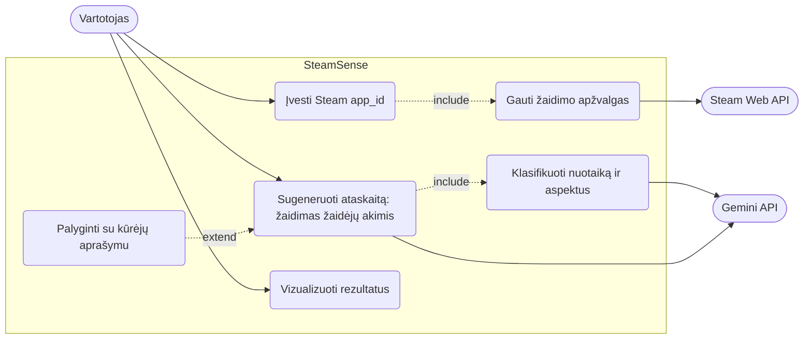
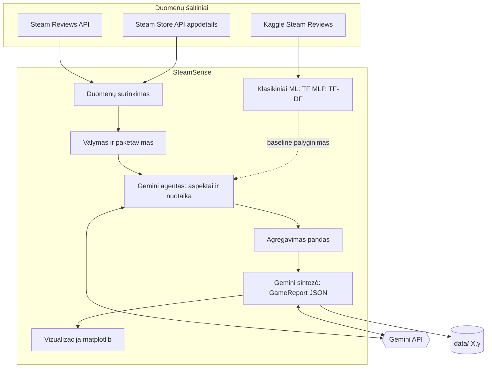
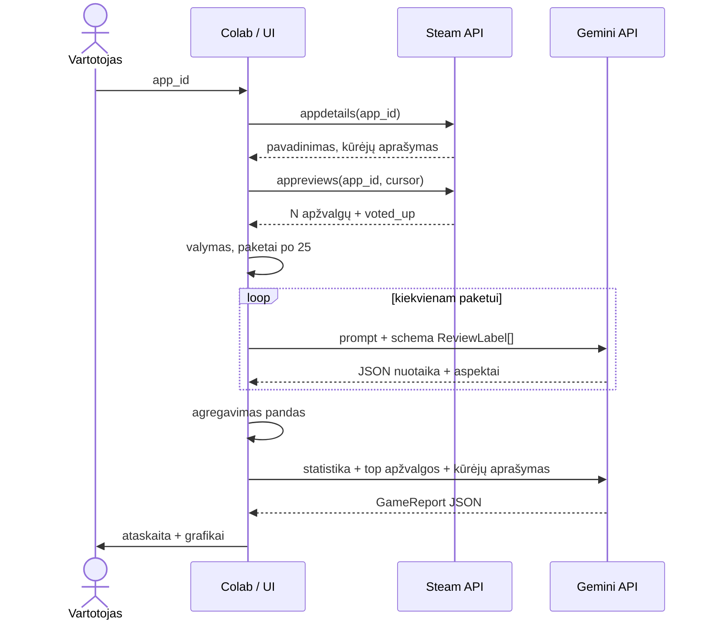
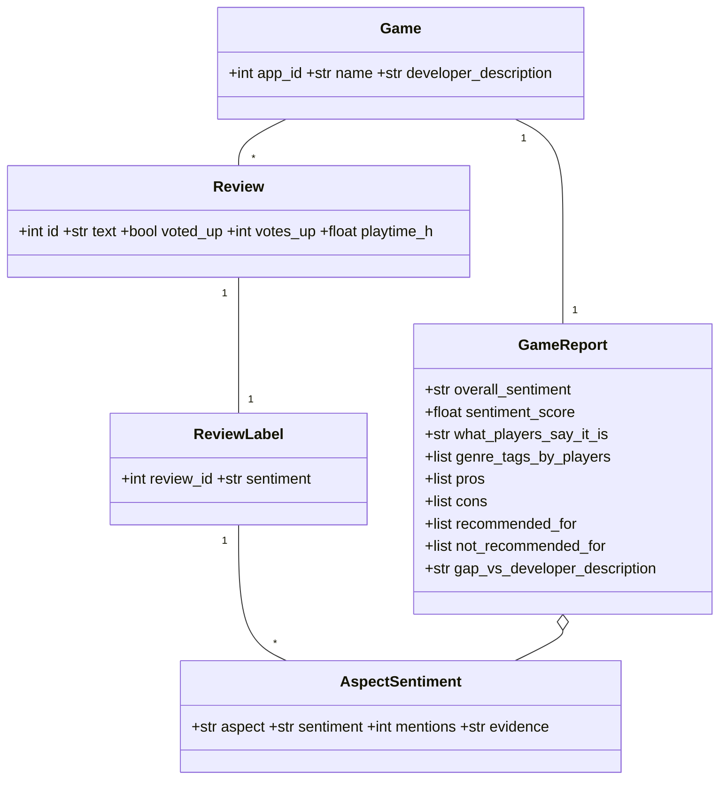

# 🎮 SteamSense: žaidimas žaidėjų akimis

**Tema:** Sentimento analizė apie vaizdo žaidimus „Steam“ platformoje.
**Idėja:** kūrėjų aprašymas parduoda svajonę, o Steam apžvalgos parodo realybę. Sistema skaito žaidėjų apžvalgas ir paaiškina, **koks žaidimas yra žaidėjų akimis**: bendrą nuotaiką, nuotaiką pagal aspektus (gameplay, graphics, performance, bugs, price, multiplayer...), žanrą žaidėjų žodžiais, privalumus ir trūkumus, kam žaidimas tinka ir kuo žaidėjų vaizdas skiriasi nuo kūrėjų aprašymo.

**Komanda:** _Eimantas Bimba_, _Mindaugas Moisiejus_ · **Dalykas / grupė:** _Gilusis Mokymas naudojant TensorFlow DIPf-24_

| Dalis | Kur | Kas |
|---|---|---|
| 1.1 | [`prompts/00_design_prompt_chatgpt.md`](prompts/00_design_prompt_chatgpt.md), [`docs/`](docs) | ChatGPT promptas, PlantUML ir Mermaid diagramos |
| 1.2.1 | [`data/`](data), [`prompts/`](prompts) | 3 End-to-End pavyzdžiai (X, y) ir testavimo promptai |
| 1.2.2 | [`notebooks/02_gemini_steam_agent.ipynb`](notebooks/02_gemini_steam_agent.ipynb) | Gemini API agento prototipas Colab'e |
| 1.3 | [`notebooks/03_tabular_tf_tfdf.ipynb`](notebooks/03_tabular_tf_tfdf.ipynb) | TensorFlow ir TF Decision Forests su Kaggle Steam apžvalgomis |
| 1.4 | [`notebooks/04_cnn.ipynb`](notebooks/04_cnn.ipynb) | CNN: žanras iš viršelio |
| 1.5 | [`notebooks/05_transfer_learning.ipynb`](notebooks/05_transfer_learning.ipynb) | Transfer learning (MobileNetV2) |

### 1.2.2

### 1.3

### 1.4

### 1.5

## Architektūra (Mermaid)

### Panaudojimo atvejai

### Komponentai

### Sekų diagrama (End-to-End srautas)

### Duomenų modelis

PlantUML versijos: [`docs/plantuml/`](docs/plantuml) (atidaryti per https://www.plantuml.com/plantuml).

## Kaip paleisti
1. Gaukite raktą https://aistudio.google.com/apikey → Colab `🔑 Secrets` → `GEMINI_API_KEY`.
2. Atidarykite `notebooks/02_gemini_steam_agent.ipynb` Colab'e, pakeiskite `APP_ID` ir paleiskite visas ląsteles.
3. 03 reikia Kaggle prieigos (`kagglehub.login()`); 04 ir 05 reikia GPU (T4).

## Apribojimai
Ironija ir memai, daugiausia analizuojama anglų kalba, imtis nėra visos apžvalgos, LLM atsakymai nedeterministiniai (naudojame `temperature` 0,1-0,2 ir JSON schemą).
